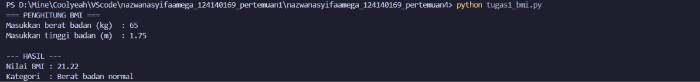
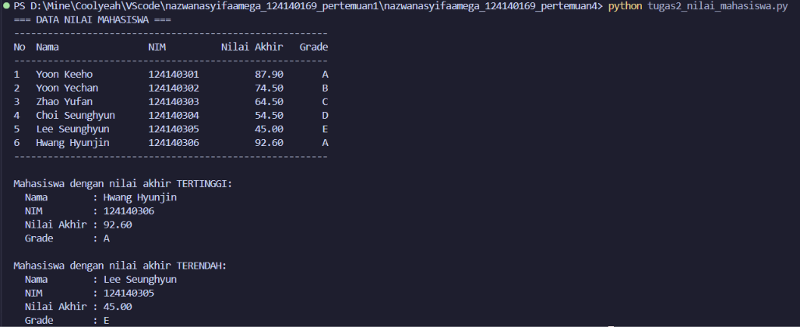
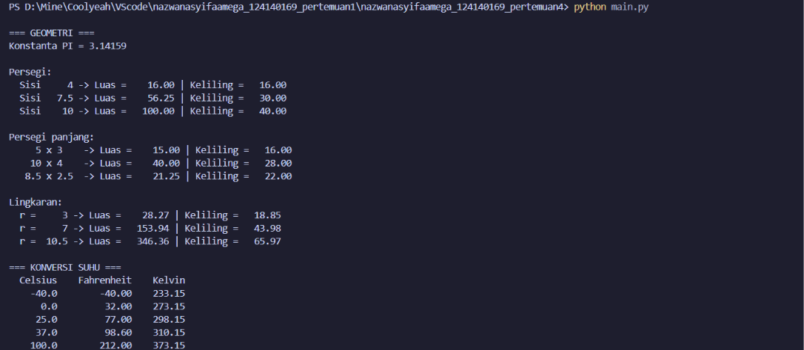

# Tugas Pertemuan 4: Dasar Pemrograman Python

**Praktikum Pengembangan Aplikasi Web - Pertemuan 4 (Python Dasar)**

- Nama: Nazwa Nasyifaa Mega
- NIM: 124140169
- Kelas: PAW RA

## Deskripsi Program

### 1. `tugas1_bmi.py` - Penghitung BMI

Program meminta berat badan (kg) dan tinggi badan (m) lewat `input()`, lalu menghitung `BMI = berat / (tinggi * tinggi)`. Input divalidasi: harus berupa angka, lebih dari 0, dan tinggi maksimal 3 meter. Hasil BMI ditampilkan dengan 2 angka desimal beserta kategorinya:

| BMI | Kategori |
|---|---|
| kurang dari 18.5 | Berat badan kurang |
| 18.5 sampai kurang dari 25 | Berat badan normal |
| 25 sampai kurang dari 30 | Berat badan berlebih |
| 30 atau lebih | Obesitas |

Fungsi: `hitung_bmi()`, `tentukan_kategori()`, `baca_angka_positif()`, `main()`.

### 2. `tugas2_nilai_mahasiswa.py` - Pengelolaan Data Nilai Mahasiswa

Data 6 mahasiswa disimpan dalam **list berisi dictionary** (kunci: `nama`, `nim`, `nilai_uts`, `nilai_uas`, `nilai_tugas`). Program menghitung nilai akhir `(30% x UTS) + (40% x UAS) + (30% x Tugas)`, menentukan grade (A: 80 atau lebih, B: 70-79, C: 60-69, D: 50-59, E: kurang dari 50), mencetak tabel yang rapi, lalu menampilkan mahasiswa dengan nilai akhir tertinggi dan terendah. Data NIM dan nama pada program ini hanya contoh.

Fungsi: `hitung_nilai_akhir()`, `tentukan_grade()`, `proses_nilai()`, `cetak_tabel()`, `cetak_info()`, `main()`.

### 3. `math_operations.py` dan `main.py` - Modul Matematika

`math_operations.py` adalah modul yang berisi konstanta `PI = 3.14159`, fungsi luas dan keliling (persegi, persegi panjang, lingkaran), serta konversi suhu (Celsius ke Fahrenheit dan Celsius ke Kelvin).

`main.py` memakai seluruh fungsi tersebut dengan beberapa nilai uji dan menampilkan hasilnya dalam format rapi. Program ini memakai dua cara impor:
- `import math_operations` (dipanggil dengan awalan `math_operations.`)
- `from math_operations import celsius_ke_fahrenheit, celsius_ke_kelvin, PI`

## Cara Menjalankan

Pastikan Python 3 sudah terpasang (`python --version`). Buka terminal di folder ini (VS Code: **Terminal -> New Terminal**), lalu jalankan:

```bash
python tugas1_bmi.py
python tugas2_nilai_mahasiswa.py
python main.py
```

Jika perintah `python` tidak dikenali, gunakan `python3`.

## Screenshot Hasil Eksekusi

### Soal 1: BMI


### Soal 2: Nilai Mahasiswa


### Soal 3: Modul Matematika


## Struktur Folder

```
nazwanasyifaamega_124140169_pertemuan4/
├── .gitignore
├── README.md
├── tugas1_bmi.py
├── tugas2_nilai_mahasiswa.py
├── math_operations.py
├── main.py
└── screenshots/
```

Kode ditulis sesuai PEP 8 (indentasi 4 spasi, penamaan `snake_case`), dan setiap fungsi memiliki docstring.
